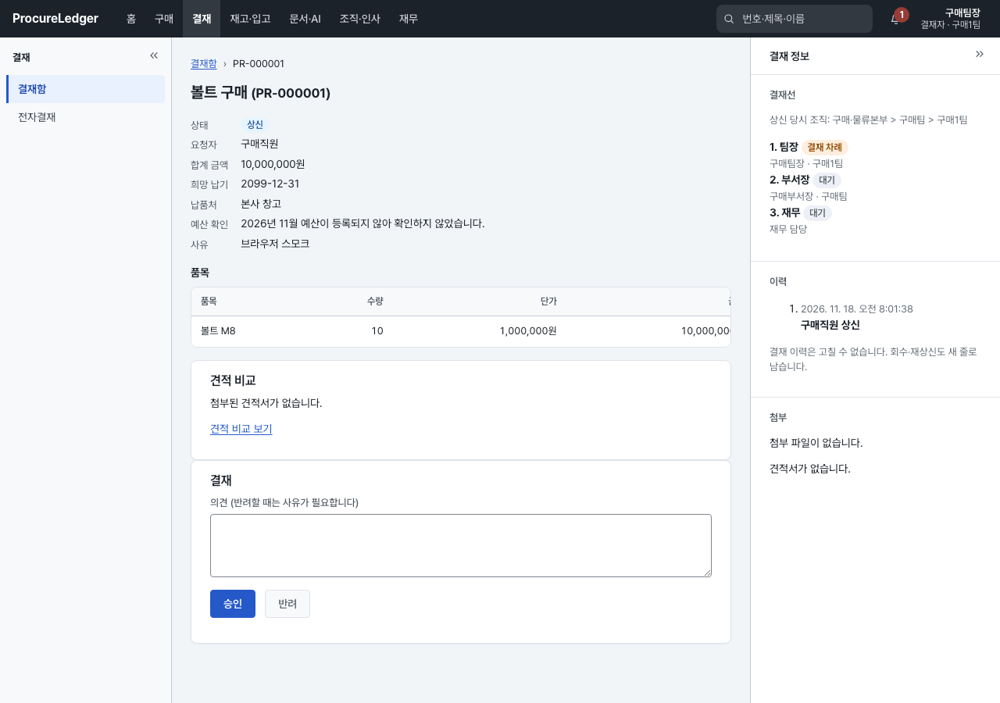
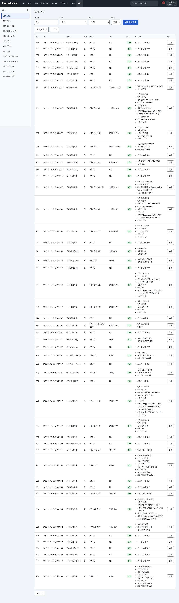
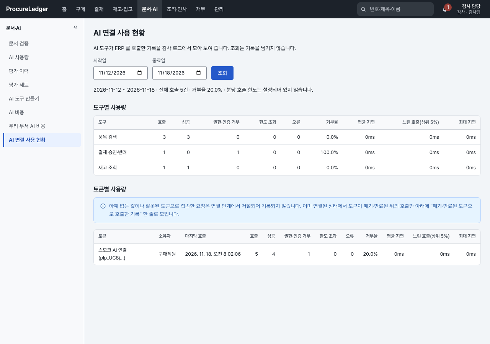
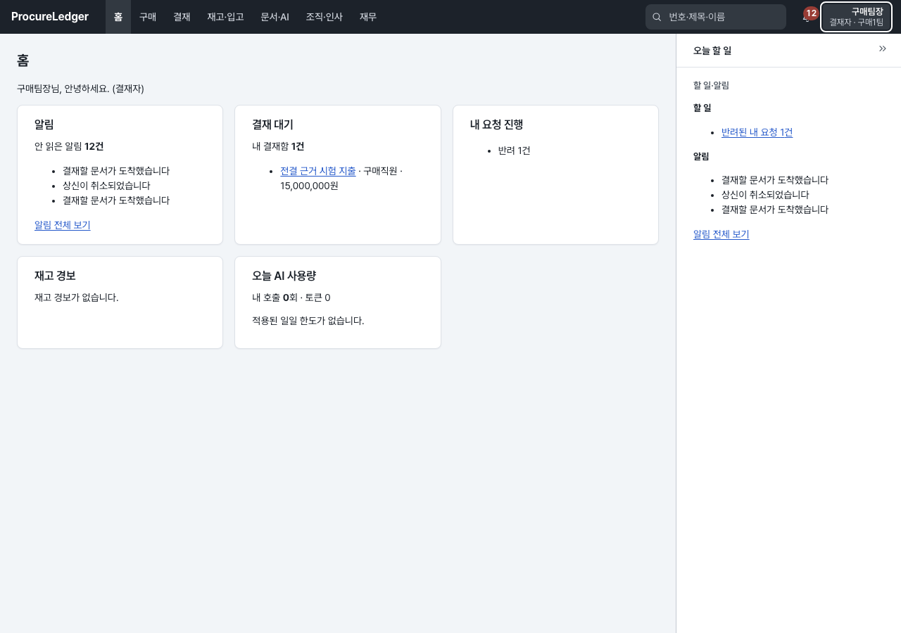

# ProcureLedger

구매요청 → 전자결재 → 발주·입고 → 재고·원가 → 전표까지 이어지는 작은 사내 ERP 입니다. 모든 쓰기는 해시 체인 감사 로그와 같은 트랜잭션에 남고, 바뀐 내용은 **변경 피드와 서명된 웹훅**으로 밖에 알립니다. 같은 서비스 계층을 **MCP 도구와 LLM 게이트웨이**도 지나가므로 AI 연결에도 웹과 같은 권한·감사가 적용됩니다.

- 테스트 규모: Go 테스트 함수 약 1,860개, 프론트 730개, 서버를 띄워 도는 e2e 스모크([docs/TEST_CASES.md](docs/TEST_CASES.md))
- 백엔드: Go 단일 바이너리(프론트 임베드), SQLite 기본 / PostgreSQL 선택
- 프론트: React 19 + Vite
- 인증: OIDC·SAML·TOTP, 개인 토큰과 연동 토큰은 해시로만 저장
- 외부 연동: 읽기·쓰기 REST `/api/v1`(OpenAPI), 커서 기반 변경 피드, 변경 웹훅, SCIM
- AI: LLM 게이트웨이(공급자 추상화·마스킹·한도·비용 배부), MCP 도구, 평가 러너(`cmd/eval`)

## 둘러보기 시나리오 3개

개발용 로그인(`PL_DEV_IDP=1`)으로 비밀번호 없이 역할별 계정으로 들어갑니다. 계정 목록은 아래 "5분 실행"에 있습니다.

1. **구매요청에서 입고까지(결재·권한·감사).** 구매직원으로 요청을 올리면 결재선이 조직도에서 만들어지고(금액 구간·전결 규정·예산 초과 시 재무 단계 추가), 팀장 → 부서장 → 재무 순서로 승인하면 발주가 생기고 재무가 입고를 처리합니다. 자기 결재는 막히고, 감사 담당 계정의 "감사 로그"에서 "변조 여부 검증"으로 해시 체인을 확인합니다.
2. **변경 피드와 웹훅(이벤트 기반 연동).** 관리자가 연동 토큰을 발급하고 `GET /api/v1/changes` 로 커서를 따라 읽습니다. 웹훅 구독을 등록하면 변경이 생길 때 서명된 알림이 가고(재시도·비밀 교체·분당 한도), 값은 API 로 다시 읽습니다. 절차는 [docs/integrations.md](docs/integrations.md).
3. **AI 연결(MCP·게이트웨이·평가).** 개인 토큰으로 AI 도구를 `/mcp` 에 붙이면 호출자의 권한으로만 도구가 돌고 호출마다 감사에 남습니다. 요청 전 개인정보 마스킹, 모델 허용 목록·일일 한도, 공급자 장애 대체는 게이트웨이가 맡고, `go run ./cmd/eval --provider mock` 이 골든셋 합격률을 잽니다. [docs/mcp-connect.md](docs/mcp-connect.md)

## 화면

개발용 로그인으로 돌린 화면입니다(`make verify-ui` 가 만든 것).

| | |
|---|---|
|  결재: 조직도에서 만든 결재선과 이력을 보고 승인·반려합니다. |  감사 로그: 모든 쓰기가 남고 "변조 여부 검증"으로 해시 체인을 확인합니다. |
|  AI 연결 사용 현황: 도구별·토큰별 호출과 거부. |  홈: 역할에 맞는 카드만 보입니다. |

## 테스트

Go 테스트 함수 약 1,860개와 프론트(vitest) 730개, 그리고 서버를 실제로 띄워 도는 e2e 스모크(`scripts/e2e.sh`)가 있습니다. 대표 시나리오와 영역별 개수는 [docs/TEST_CASES.md](docs/TEST_CASES.md) 에 정리했습니다.

```
make test      # Go 테스트
make verify    # go vet·go test·gofmt, 권한 선언 검사, 프론트 타입·테스트·빌드, 평가 러너, e2e
```

## 5분 실행

필요한 것: Go(`go.mod` 의 버전), Node 22 와 npm. Docker 는 필요 없습니다.

```
make build
PL_DEV_IDP=1 ./bin/server
```

처음 `make build` 는 프론트 의존성(`npm ci`)을 받느라 몇 분 걸립니다. 서버가 뜨면 브라우저에서 <http://localhost:8080> 을 엽니다. 로그인 화면의 "개발용 계정"을 누르면 비밀번호 없이 들어갑니다. 데이터는 `data/erp.db`(SQLite)에 생기고 처음 기동할 때 마이그레이션이 적용됩니다.

`PL_DEV_IDP=1` 은 로컬 검증용 로그인 서버(dev IdP)를 켭니다. 접속 주소(`PL_BASE_URL`)가 로컬 주소가 아니거나 외부 IdP(`PL_OIDC_ISSUER`)와 함께 켜면 기동이 실패하고, 운영 이미지에서는 꺼져 있습니다.

### 개발용 계정

`PL_DEV_IDP=1` 로 처음 기동하면(조직 정보가 없는 새 DB 일 때만) 개발용 조직도도 함께 들어갑니다. 본부 4·부서 5·팀 12(폐지 조직 1)와 재직 약 60명이고, 겸직 조직장, 조직장 공석과 직무대행, 퇴사·재입사, 예약 전보, 취소·정정 이력, 동명이인 같은 사례가 있습니다. 이미 예전 버전으로 만든 `data/erp.db` 는 조직 정보가 이미 있어 이 시드가 들어가지 않으니 **새 DB 를 쓰세요**(`PL_DB_PATH` 를 바꾸거나 파일을 지웁니다). 아래 9개 계정 말고 시드 인물(`p001@pl.test` 등)로도 로그인할 수 있습니다. 로그인 화면 목록에는 없고 주소 `/api/auth/login?login_hint=p001@pl.test` 로 들어갑니다.

| 계정 | 이름 | 역할 | 소속(조직도 주소속) |
|---|---|---|---|
| `admin@pl.test` | 관리자 | 관리자 | 경영지원팀 |
| `finance@pl.test` | 재무 담당 | 재무 | 재무팀 |
| `finance2@pl.test` | 재무 담당2 | 재무 | 재무팀 |
| `lead@pl.test` | 구매팀장 | 결재자 | 구매1팀 |
| `lead2@pl.test` | 구매부팀장 | 결재자 | 구매2팀 |
| `head@pl.test` | 구매부서장 | 결재자 | 구매팀 |
| `staff@pl.test` | 구매직원 | 직원 | 구매1팀 |
| `staff2@pl.test` | 영업직원 | 직원 | 영업1팀 |
| `auditor@pl.test` | 감사 담당 | 감사 | 감사팀 |

처음 해 볼 흐름: 재무(또는 관리자)로 로그인해 "재고" 화면의 "품목·거래처 등록"에서 거래처와 품목을 등록하고(같은 일을 하는 API 는 `POST /api/vendors`, `POST /api/items` 이고 요청 예는 `scripts/e2e.sh`), 직원으로 구매요청을 올려 상신한 뒤, 결재선은 조직도에서 만들어집니다(요청자 주소속에서 위로 올라가며 조직장을 찾고, 공석이면 직무대행). 금액이 1천만 원 이상 1억 원 미만이면 팀장 → 부서장 → 재무, 1억 원 이상이면 팀장 → 부서장 → 본부장 → 재무 순서로 로그인해 승인합니다(금액이 작으면 결재선이 짧아집니다). 팀장이 올린 요청은 한 단계 위 부서장부터 결재합니다. "전자결재" 메뉴에서는 양식(일반 기안서·지출 결의서·업무 협조전·구매 품의서)을 골라 기안합니다. 결재 외에 합의(여러 명이 병렬로 동의하고 이견이 있으면 반려), 참조, 수신 단계를 결재선에 넣을 수 있고, 자주 쓰는 결재선은 개인 결재선으로 저장해 불러옵니다. 증빙 등 첨부 파일은 문서에 붙여 올리며 DB 에 저장됩니다(상한은 아래 설정 표). 문서함(기안·결재 대기·결재 진행·완료·참조·수신·반려)에서 내 문서를 모아 보고 안 읽은 문서를 구분하며, 결재 대기함에서는 여러 건을 일괄 승인할 수 있습니다(승인·동의만, 한 번에 50건까지). 아무도 처리하지 않은 문서는 기안자가 상신을 취소하고(결재자가 없어 멈춘 건은 처리 이력이 있어도 "회수"로 임시저장에 되돌립니다), 결재가 끝난 문서는 수신처(조직장 또는 수신 담당자)가 접수·담당자 지정·처리 완료·반송합니다. 양식은 관리자가 "결재 양식" 메뉴에서 필드·본문·기본 결재선·번호 규칙을 고쳐 새 버전으로 게시하고, "전결 규정" 메뉴에서 양식·금액 구간별 최종 결재자와 근거 조항을 정합니다(개발용 시드는 지출 결의서 1천만 원 이상 3천만 원 미만은 부서장이 최종 결재자이고 재무 단계는 전결로 건너뜁니다. 결재 화면·상세·출력에 "전결 근거"가 보이고 누르면 조항 원문이 열립니다). 문서 화면의 "출력 화면"은 결재란·수신·참조·결재 의견이 있는 A4 틀이고 브라우저 인쇄로 뽑으며, 출력은 감사 로그(`document.print`)에 남습니다. 결재자가 퇴사하는 등으로 멈춘 건은 관리자가 결재자를 재지정할 수 있고, 재지정과 결재 요청은 앱 안 알림(메뉴의 "알림"과 홈 카드)으로 알려 줍니다. 재고에는 이동평균 단가로 계산한 금액이 붙습니다(입고 단가로 평균을 계산하고 출고·이동·조정은 그 시점 평균으로 금액을 기록하며, 단가·금액 열은 재무·관리자·감사에게만 보입니다). 재무는 "월 마감" 탭에서 지난 달부터 순서대로 마감하며(마감 전 점검의 차단 항목이 있으면 마감되지 않음) 마감된 달의 날짜로는 출고·실사 전표·원장 기록을 만들 수 없고, 해제는 전자결재 양식("월 마감 해제 요청서", 재무팀장 결재)으로만 합니다. "월별 재고 현황"은 마감 때 저장한 품목·창고별 월말 재고(이번 달은 잠정 값)를 보여 주고 엑셀로 내려받을 수 있습니다. 마지막 승인에서 발주가 만들어지고, 재무가 입고를 처리합니다(입고 창고를 고르며 기본은 본사 창고). "재고" 화면에는 재고·출고·창고 이동·실사·수불부 탭이 있습니다. 출고는 부서를 골라 로트를 선입선출(또는 유효기한 임박 우선, 직접 고르기)로 나누고 유효기한이 지난 로트는 막습니다. 창고 이동은 결재 없이 즉시 처리되고, 재고 실사는 실제 수량을 입력해 차이를 확인한 뒤 "재고 조정 전표"(구매팀장 → 재무 결재)를 상신하며 최종 승인 때 재고가 조정됩니다(재무가 올린 전표는 다른 재무 담당이 결재하므로 개발용 계정에 `finance2@pl.test` 가 있습니다). 재무는 "예산 현황" 메뉴에서 부서·월 예산을 등록·수정하고(사유 필수, 이력이 남고, 삭제는 없음), 구매요청을 작성하면 본인 부서의 잔액을 확인하는 카드가 보입니다. 예산을 넘겨도 상신은 되지만 결재선에 재무 단계가 더해지고 상세 화면에 "예산 초과 요청" 배지가 남습니다. 구매요청에는 희망 납기(선택)와 납품처도 적습니다. 관리자는 "조직 일괄 반영" 메뉴에서 인사 시스템의 조직·사람·발령 CSV(UTF-8 또는 EUC-KR)를 올려 미리보기를 보고(서명된 미리보기라 10분 안에 같은 내용만 반영되고, 오류가 있으면 반영되지 않으며, 퇴사·전보로 결재자가 사라지는 진행 중 건도 미리 알려 줍니다) 한 번에 반영합니다. 결재·합의자가 사라진 진행 중 건은 "조직 관리"의 점검 탭과 관리자 홈 카드에 모이고 거기서 결재자를 바꿉니다. 감사 담당으로 "감사 로그"에서 기록을 보고 "변조 여부 검증"을 눌러 볼 수 있습니다.

## 기능과 구현 위치

| 항목 | 내용 | 구현 위치 |
|---|---|---|
| F1 | 구매요청·전자결재(금액 구간별 결재선, 위임, 자기 결재 금지) | `internal/service`(구매·결재), `internal/repository`, `internal/handler`, `web/src/purchase`, `web/src/approval` |
| F2 | 재고·입고(원장 합계, 부분 입고, 초과 입고 금지, 안전재고) | `internal/service`(재고), `internal/repository`, `web/src/inventory` |
| B25 단계 1 | 구매 깊이: 부서·월 예산과 수정 이력(재무만 수정, 재무·관리자·감사 조회), 구매요청 작성의 예산 확인 카드, 상신 때 예산 초과 판정 스냅샷과 재무 단계 강제, 희망 납기·납품처 | `internal/service/budget_service.go`, `internal/repository/budget_repo.go`, `internal/handler/budget_register.go`, `web/src/purchase`(`BudgetPage`·`BudgetCheckCard`), `migrations/0022_*`, 명세 [해당 기능 명세] |
| B28 | 업무 보고서와 엑셀 내보내기: 공통 내보내기 부품(CSV UTF-8 BOM·XLSX, 상한·속도 제한·감사·원문 포함 재판정), 목록 9종(구매요청·발주·입고·재고 현황·수불부·문서함·감사 로그·조직 구성원·예산 현황) 내보내기, 보고서 3종(부서·월별 구매 실적, 거래처별 실적·평가, 결재 소요 시간), `report:read` | `internal/export`, `internal/handler/export_sources.go`, `internal/service`(보고서·목록 내보내기), `web/src/reports`, `web/src/layout/ExportButtons.tsx`, 명세 [해당 기능 명세] |
| B27 | 월 마감과 재고 평가: 이동평균 단가·재고 금액, 월 마감(마감된 달의 출고·실사·원장 쓰기 거부)과 마감 해제 요청서(MCR, 재무팀장 결재), 월별 재고 현황(스냅샷·엑셀 내보내기), MCP `get_month_close_status` | `internal/service`(평가·마감), `internal/repository`, `web/src/inventory`, `migrations/0025_*`~`0027_*`, 명세 [해당 기능 명세] |
| B24 | 재고 깊이: 창고 마스터, 부서 사용 출고(선입선출·만료 로트 차단), 창고 이동, 입고 창고, 창고별 재고, 실사와 조정 전표(ADJ)·승인 훅, 수불부, MCP `get_item_ledger` | `internal/service`(재고), `internal/repository/stock_count_repo.go`, `web/src/inventory`, `migrations/0019_*`~`0021_*`, 명세 [해당 기능 명세] |
| F3 | 증빙 문서 판정(추출은 LLM, 대조는 코드, 확정은 사람) | `internal/docverify`, `web/src/docverify` |
| B20 | 조직도·인사 발령(이벤트 로그가 정본, 기준일 조회, 예약·소급, 퇴사 처리, 호환 투영) | `internal/org`, `internal/handler/org_register.go`, `web/src/org`, `migrations/0010_*`, 명세 [해당 기능 명세] |
| B23 | 전자결재 표준: 양식 4종(일반 기안서·구매 품의서·지출 결의서·업무 협조전), 결재·합의·참조·수신 결재선과 개인 결재선, 첨부(DB 저장) | `internal/service`(양식·문서·첨부), `internal/handler/approval_doc_register.go`, `web/src/document`, `migrations/0013_*`~`0016_*`, 명세 [해당 기능 명세] |
| B23 단계 3 | 전결 규정(양식·금액별 최종 결재자, 근거 조항 표시, 스냅샷 저장), 결재 문서 출력 화면과 출력 감사, 열람 감사, 문서 갱신 차수(읽음 판정) | `internal/service`(전결·출력), `internal/handler/authority_register.go`, `web/src/document`, `migrations/0017_*`, `0018_*` |
| B22 | 조직 CSV 일괄 반영(인코딩 판별·계획·서명 미리보기·반영·오류 행 내려받기), 결재·합의자 소멸 목록과 관리자 홈 카드, 퇴사·전보 미리보기의 진행 중 문서, MCP 조직 도구(`search_people`·`get_org_unit`·`who_approves`) | `internal/org`(`import_*.go`), `internal/handler/org_import.go`, `web/src/org`, `internal/mcp`, 명세 [해당 기능 명세] |
| B21 | 조직도 기반 결재선·열람 범위, 결재자 재지정, 앱 안 알림 | `internal/service`(결재선), `migrations/0011_*`, 명세 [해당 기능 명세] |
| 공통 | 인증(OIDC + dev IdP)·세션·개인 토큰 | `internal/auth` |
| 공통 | 선언형 권한 | `internal/contract`(`permission.go`, `router.go`), `internal/rbac` |
| 공통 | 해시 체인 감사 로그, 외부 앵커 | `internal/audit`, `internal/contract/audit` |
| 공통 | 개인정보 마스킹 | `internal/rbac/mask.go` |
| 공통 | 사내 규정 검색(구매 화면의 관련 규정) | `internal/policysearch`, `docs/policies` |

## 자주 쓰는 명령

| 명령 | 하는 일 |
|---|---|
| `make verify` | 완료 판정. go vet·go test, 권한 선언 누락 검사, 프론트 타입·테스트·빌드, 평가 러너(mock), e2e 스모크, 커밋 메시지 검사를 돈다. |
| `make verify-ui` | 헤드리스 브라우저로 화면을 돌고 스크린샷을 `ui-screenshots/` 에 남긴다(선택). |
| `make verify-pg` | 로컬에 설치된 PostgreSQL 의 임시 클러스터(유닉스 소켓, 기존 PG 서버는 건드리지 않음)로 PG 용 시험을 돈다. PG 가 없으면 "건너뜀"을 표시한다(선택). |
| `make verify-docker` | Docker 가 있는 머신에서 이미지 빌드·기동·헬스체크를 확인한다(선택). |
| `make build` | 프론트를 빌드하고 `bin/` 에 `server`, `erp-mcp`, `eval` 을 만든다. |
| `make test` | `go test ./...` 만 돈다. |
| `make openapi` | 연동 API(`/api/v1`)의 OpenAPI 문서 `docs/openapi/v1.json` 을 라우트 선언표에서 다시 생성한다. 라우트·응답 형을 바꾼 뒤에 돌린다. |
| `make connector-demo` | 커넥터 예시(`examples/connector`)를 시험용으로 조립한 서버 위에서 돌린다: 거래처·전표 초안을 들이고 거래처를 CSV 로 내보낸다. 설명은 [연동 가이드](docs/integrations.md). |
| `make openapi-check` | 저장소의 OpenAPI 문서가 라우트 선언표에서 생성한 결과와 같은지, 라우트·문서·오류 코드가 어긋나지 않는지 본다(`make verify` 의 `go test` 에도 들어 있다). |
| `make clean` | 빌드 산출물을 지운다. |

## 설정

환경변수는 [.env.example](.env.example) 에 전부 있습니다. 서버는 `.env` 파일을 직접 읽지 않으므로 셸에서 내보내거나 `docker run --env-file` 로 넘깁니다. 자주 쓰는 것만 적습니다.

| 이름 | 뜻 |
|---|---|
| `PL_ADDR` | 대기 주소(기본 `:8080`) |
| `PL_DB_PATH` | SQLite 파일(기본 `data/erp.db`) |
| `PL_DB_URL`, `PL_DB_MAX_CONNS`, `PL_DB_ALLOW_INSECURE` | PostgreSQL 연결(`postgres://`, 지정하면 `PL_DB_PATH` 는 무시). 연결 풀 상한(기본 10), 루프백의 평문 연결 허용(로컬 개발). 원격 호스트는 `sslmode=require` 이상이어야 한다 |
| `PL_DEV_IDP` | 1 이면 dev IdP 로 로그인(로컬 전용) |
| `PL_DEV_SEED_PASSWORD` | 개발 시드 계정의 이메일 로그인 초기 비밀번호(아래 운영 메모). 개발·시연 전용 |
| `PL_BACKUP_DIR`, `PL_BACKUP_KEY`, `PL_BACKUP_KEEP`, `PL_PG_DUMP` | `erp-admin backup`·`restore` 의 백업 디렉터리, 암호화 키(비밀, 16자 이상), 보존 개수(기본 14), PostgreSQL 용 `pg_dump` 경로. 명령은 `erp-admin` 도움말과 [해당 기능 명세] 6~7절 |
| `PL_REHEARSAL` | 복구 리허설 모드(1). 임시 위치의 복구본에서만 켠다: 주기 작업·메일/웹훅 발송·앵커 기록 없음. 운영 경로·PG 에서는 기동 거부 |
| `PL_SETUP_CODE` | 설치 마법사의 설치 코드를 직접 정함(16자 이상, 비밀). 비우면 기동 때마다 무작위 코드를 서버 로그에만 출력. 빈 DB 첫 기동 때만 쓰임 |
| `PL_SAML_SP_CERT_PATH`, `PL_SAML_SP_KEY_PATH` | SAML SP 인증서·키 파일 경로(키 파일 권한 0600, 저장소 밖). 나머지 로그인 방식 변수는 [docs/auth-providers.md](docs/auth-providers.md) |
| `PL_OIDC_ISSUER`, `PL_OIDC_CLIENT_ID`, `PL_OIDC_CLIENT_SECRET` | 외부 IdP 로 로그인(표준 Authorization Code + PKCE) |
| `PL_ATTACH_MAX_FILE_BYTES`, `PL_ATTACH_MAX_FILES`, `PL_ATTACH_MAX_TOTAL_BYTES` | 결재 문서 첨부 상한(파일당 10MB·문서당 20개·합계 50MB가 기본). 0 이하이거나 숫자가 아니면 기동이 거부됩니다 |
| `PL_EXPORT_MAX_ROWS` | 목록·보고서 엑셀(XLSX)·CSV 내보내기 1회 상한 행 수(기본 10000, 100~100000). 넘으면 자르지 않고 거부하며, 범위 밖 값이면 기동이 거부됩니다 |
| `PL_MAX_ACTIVE_TOKENS` | 사용자당 유효 개인 토큰 개수 상한(기본 10, 0 이면 제한 없음) |
| `PL_SCIM_MAX_ACTIVE_TOKENS`, `PL_SCIM_RATE_PER_MIN`, `PL_SCIM_LOG_KEEP_DAYS`, `PL_SCIM_ALLOW_CIDR` | SCIM 계정 동기화(관리자 화면 "계정 동기화"): 출처별 유효 연동 토큰 상한(기본 2), 토큰당 분당 호출 한도(기본 600, 0 이면 끔), 동기화 기록 보존 일수(기본 365), 요청을 받을 출발지 CIDR 목록(비면 제한 없음) |
| `PL_MCP_RATE_PER_MIN`, `PL_MCP_RATE_PER_USER_PER_MIN` | AI 연결 분당 호출 한도(토큰별, 사용자별 합산). 0 이면 꺼짐 |
| `PL_LLM_PROVIDER`, `PL_LLM_MODEL` | LLM 공급자(`mock` 기본, `anthropic`)와 모델 ID. 설명은 [evals/README.md](evals/README.md) |

### 운영 메모

- **계좌번호 암호화 키(개발·시연 포함)**: 거래처·회사 계좌번호는 `PL_ACCOUNT_SECRET_KEY`(base64 32바이트)로 암호화해 저장합니다. 키가 없으면 기동은 되지만 계좌번호를 저장할 수 없으니, 테일넷 미리보기 같은 개발 서버에서도 먼저 `openssl rand -base64 32` 로 키를 만들어 `PL_ACCOUNT_SECRET_KEY='<생성한 값>' ./bin/server` 처럼 넣으세요. 한 번 정한 키는 계속 같은 값을 써야 하고(바꾸면 저장된 계좌번호를 풀 수 없고 키 회전은 후속), 실제 값은 저장소·로그에 남기지 않습니다. 기존 평문 계좌번호는 키를 넣고 기동하면 한 번 암호화됩니다.
- **알림 웹훅(슬랙·팀즈·카카오워크)**: 관리자 화면 "알림 채널"에서 채널(방) 단위로 등록합니다. 주소는 위 계좌번호 암호화 키(`PL_ACCOUNT_SECRET_KEY`)로 봉인해 저장하고(키가 없으면 등록할 수 없음) 화면·감사·기록에는 호스트만 보입니다. 기본 허용 호스트(슬랙 hooks.slack.com, 팀즈 워크플로 웹훅, 카카오워크 api.kakaowork.com)만 받고 내부 주소(사설·루프백·메타데이터)로 연결되는 주소는 연결 직전에 거부합니다. 방에는 알림 종류·건수·앱 링크만 나갑니다. 로컬 시험에서 모의 웹훅 서버(루프백 http)를 쓰려면 `PL_NOTIFY_INSECURE_LOCAL=1` 을 켭니다(운영 금지).
- **개발 시드 계정으로 이메일 로그인(폰·다른 기기 미리보기)**: dev IdP 는 비밀번호가 없어 로컬 주소에서만 켜지므로, 테일넷 같은 https 주소로 여는 미리보기는 `PL_DEV_SEED_PASSWORD` 를 쓰세요. 예: `PL_BASE_URL=https://<호스트>.ts.net PL_DEV_SEED_PASSWORD='<10자 이상·3종 이상>' ./bin/server`(`PL_DEV_IDP` 는 비웁니다). 새 DB 에서는 개발 시드(사용자·조직)가 들어가고, 이메일 로그인 자격이 아직 없는 시드 계정 전부에 이 값으로 argon2id 자격이 만들어지며 **첫 로그인에서 비밀번호 변경이 강제됩니다**(변경 전에는 변경 화면만 열림). 이미 자격이 있는 계정은 덮어쓰지 않고 다시 기동해도 같습니다. 정책(10자·3종)에 맞지 않는 값이면 기동이 거부되고, `@pl.test` 가 아닌 사용자가 있는 DB(운영 데이터)에서는 경고 한 줄만 남기고 무시합니다. 값은 로그·감사에 남지 않습니다(감사에는 만든 계정 수만). `tailscale serve` 처럼 https 를 끝내고 localhost http 로 넘기는 프록시 뒤에서도 세션 쿠키 Secure·출처 검사는 `PL_BASE_URL` 기준입니다. 프록시 뒤에서는 로그인 시도 속도 제한(IP 당 분당 20회)이 모든 사용자에게 한 IP 로 보인다는 점에 유의하세요.
- 예산은 부서·월 단위이고 예산이 등록되지 않은 부서·월은 잔액을 확인하지 않습니다(상태 "미등록"). 예산 월은 상신한 날이 속한 달(KST)이고 금액은 공급가액입니다.
- 내보내기: 목록마다 "엑셀(XLSX)"·"CSV" 단추가 있고 화면의 필터 그대로 현재 열람 범위 안의 자료만 내려받습니다. 1회 상한은 `PL_EXPORT_MAX_ROWS`(기본 10,000행)이며 넘으면 자르지 않고 조건을 좁히라고 안내합니다. 연락처 같은 민감 열은 관리자·재무도 기본으로 가려지고 "원문 포함"을 직접 고를 때만 원문이 나오며(확인 대화상자, 감사에 표시) 모든 내보내기는 감사 로그(`export.run`)에 남습니다(검색어는 값 없이 "입력함"만). 파일 생성은 표준 라이브러리만 쓰므로 실제 Excel·LibreOffice 에서 여는 확인은 사람이 해 보세요. 보고서의 결재 소요 시간은 주말·공휴일을 빼지 않은 실제 경과 시간입니다.
- 루트에서 `go build` 를 돌리면 생기는 산출물(`/server` 등)은 .gitignore 가 막고, 실행 파일·3MB 초과 파일이 추적되면 `make verify` 의 `internal/cicheck` 가 실패합니다(빌드 산출물은 `bin/` 에만 둡니다).
- 월 마감 해제 요청서(MCR)의 결재선은 재무팀(개발 시드 조직 코드 `T-FIN`)의 조직장 단독이고 감사가 참조입니다. 운영 조직의 재무팀 코드가 다르면 "결재 양식"에서 새 판을 게시하세요. 재무 담당이 요청자 본인이 재무팀장이면 한 단계 위로 올라갑니다. 마감은 `inventory:close`(재무만), 단가·금액 조회는 `inventory:valuation_read`(재무·관리자·감사)입니다.
- 마감 흐름을 실제 서버로 확인하는 e2e(`scripts/e2e.sh` 의 B27 대표 흐름)는 지난 달 날짜의 재고 기록이 필요해 시험 전용 도구 `internal/tools/monthclosefixture`(`go run ./internal/tools/monthclosefixture -db <DB>`)로 저장소 함수를 통해 지난 두 달 원장을 넣습니다. 이 도구는 서버 바이너리에 들어가지 않고 운영 코드에 시계를 조작하는 경로는 없습니다(운영 DB 에 쓰지 마세요).
- 재고 조정 전표(ADJ)의 첫 결재 단계는 조직 코드 `DEP-PU`(개발 시드의 구매팀)의 조직장입니다. 운영 조직의 구매팀 코드가 다르면 "결재 양식"에서 "재고 조정 전표"의 첫 단계 조직을 바꿔 새 판을 게시해야 합니다. 또 재무 담당이 한 명뿐이면 재무가 올린 조정 전표는 재무 단계의 다른 후보가 없어(자기 결재 금지) 상신되지 않으므로 재무 담당은 2명 이상이어야 합니다.

## 라이선스

GNU Affero General Public License v3.0 입니다. 전문은 [LICENSE](LICENSE) 에 있습니다. 이 프로그램을 수정해 네트워크로 서비스하면 그 수정본의 소스를 사용자에게 제공해야 합니다.

## 아직 확인하지 못한 것

- Anthropic 실호출(`PL_LLM_PROVIDER=anthropic`)은 API 키가 없어 실행해 보지 않았습니다. 기본인 mock 공급자로만 검증했습니다.
- 알려진 한계는 [docs/architecture.md](docs/architecture.md) 의 마지막 절에 모아 두었습니다.
