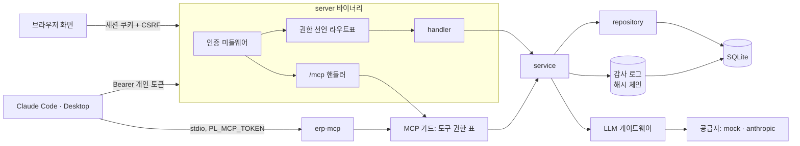

# 구성과 알려진 한계

이 문서는 ProcureLedger 가 어떻게 짜여 있는지와, 알고 있는 한계를 적습니다.

## 1. 구성

- `cmd/server` 는 웹 API, 임베드한 프론트(`web/dist`), `/mcp` 를 한 바이너리로 서빙합니다. `cmd/erp-mcp` 는 같은 서비스 조립(`internal/bootstrap`)과 같은 환경변수·같은 SQLite 파일을 쓰는 MCP 전용 실행 파일입니다. `cmd/erp-admin` 은 서버 호스트의 운영 명령(`access-recompute`, `auth-unlock`; `server` 하위 명령은 같은 구현을 부르는 호환 별칭)이고 감사 기록은 경로 "서버 명령"(cli)으로 같은 체인에 남습니다. `cmd/eval` 은 평가 러너입니다.
- 계층은 `handler → service → repository` 입니다. 인증·권한·감사·LLM 게이트웨이·MCP 는 `internal/{auth,rbac,audit,llmgw,mcp}` 에 있습니다.
- 계약(`internal/contract`)에는 역할·권한 표, 라우트 등록기, 서비스 인터페이스, 감사 기록 형식이 있고 모든 패키지가 이것을 기준으로 맞물립니다.
- 저장소는 SQLite(`modernc.org/sqlite`, cgo 없음)이고 마이그레이션은 `migrations/*.sql` 을 바이너리에 담아 기동 때 순서대로 적용합니다. 저장소 계층은 인터페이스 뒤에 있어 다른 DB 로 옮길 여지를 남겼습니다.

## 2. 요청이 지나는 길

웹 요청 하나가 쓰기까지 가는 순서입니다.

1. **인증.** 세션 쿠키(서버 측 세션, HttpOnly·SameSite) 또는 개인 토큰으로 사용자와 역할을 알아내 요청 컨텍스트에 넣습니다. 상태를 바꾸는 요청은 CSRF 토큰을 검사합니다.
2. **권한 선언.** 라우트는 `Registrar.HandleFunc(메서드, 경로, 권한, 핸들러)` 로만 등록할 수 있고, 권한이 필수 인자입니다. 등록된 모든 라우트와 MCP 도구를 순회해 선언 누락을 잡는 테스트(`TestPermissionDeclaration*`)가 `make verify` 2단계에 있습니다. 핸들러 안에서 역할을 비교하는 분기는 두지 않습니다. 로그인 방식은 이메일+비밀번호(argon2id)·구글·Microsoft Entra·SAML 2.0·범용 OIDC 이고 모두 한 함수(`resolveAccount`)가 계정 존재·활성·재직을 판정합니다(외부 로그인은 계정을 만들지 않음). 권한은 역할(기본 템플릿 5개 + 회사가 만드는 역할, B33)에 묶여 부여되고, 요청마다 계산한 실효 권한(`Principal.Perms`, 캐시 표 `user_effective_permissions`)으로 `Principal.Can` 한 곳이 판정합니다(기본 템플릿의 정본은 코드 `contract.RolePermissions`, 기동 때 DB 에 동기화). 역할 이름을 직접 비교하는 코드는 `internal/cicheck` 의 소스 검사가 허용 목록 밖에서 막습니다. 비밀번호 변경·2단계 등록 전의 제한 세션은 `Principal.Can` 한 곳에서 강제하며, 방식·정책 설정과 비밀 취급은 [auth-providers.md](auth-providers.md) 에 있습니다. SAML 의 XML 서명 검증은 검증된 라이브러리(crewjam/saml, goxmldsig)가 하고 그 위에 우리 쪽 검사를 한 번 더 겁니다. 로그인했지만 권한이 없는 요청은 403 이고 `access.denied` 로 감사 로그에 남습니다.
3. **서비스.** 서비스가 도메인 규칙(결재선, 자기 결재 금지, 초과 입고 금지 등)과 부서 격리를 적용합니다. 저장소 쿼리의 조건절이 한 번 더 막습니다.
4. **같은 트랜잭션의 감사 기록.** 쓰기 서비스는 `WithTx` 안에서 비즈니스 변경과 `Recorder.Record` 를 함께 합니다. 기록은 직전 기록의 해시를 포함해 이어 붙입니다. 기록이 실패하면 오류로 트랜잭션이 롤백되어 요청 전체가 실패합니다.
5. **응답.** 응답은 역할에 따라 사업자번호·계좌·연락처를 마스킹합니다.

## 2.1 조직도와 결재선

- **조직도(`internal/org`).** 조직 변경과 인사 발령은 추가 전용 이벤트 로그(`org_events`)가 정본입니다. 조직·사람·겸직·직무대행의 기간별 상태(구간 테이블)는 이벤트를 처음부터 다시 계산한 결과이고, 이벤트를 등록하는 같은 트랜잭션에서 다시 만듭니다. 구간 테이블은 조직 서비스 밖에서 쓸 수 없고(DB 트리거와 소스 검사 테스트), 이벤트 로그와 같은지는 점검 화면이 보여 줍니다. 그래서 어느 날짜의 조직이든 과거·예약 기준일로 조회됩니다. 효력일이 지나면 서버가 1분마다 오늘 기준 투영을 갱신합니다.
- **호환 투영.** 기존 코드가 읽던 `users.department_id`·`position`·`active` 는 조직도가 계산해 채우는 값입니다. 부서·직책을 직접 고치는 경로는 없고 인사 발령으로만 바뀝니다. 퇴사한 사람의 인증 거부는 이 투영과 무관하게 조직 상태로 직접 판정합니다.
- **조직 조회 계약.** 다른 도메인은 `internal/contract/org.go` 의 `OrgDirectory`(경로·조직장·구성원·사람 카드)만 읽습니다. 연락처는 `mask:bypass` 권한자와 본인에게만 원문이고 MCP 채널은 항상 가립니다.
- **결재선(B21).** 구매요청을 상신하면 요청자 조직에서 위로 올라가며 금액 구간이 요구하는 직책(팀장·부서장·본부장·대표·재무)의 조직장을 찾아 그 시점의 결재선과 조직을 스냅샷으로 저장합니다. 그 뒤 조직이 바뀌어도 진행 중 건의 결재자와 상신 당시 조직은 바뀌지 않고, 멈춘 건은 관리자가 미완료 직책 단계의 결재자를 사유와 함께 재지정합니다(결재 이력·감사 로그·앱 안 알림). 금액 구간 경계는 마이그레이션 데이터(`approval_line_rules`)입니다.
- **문서와 양식(B23).** 전자결재 문서는 `purchase_requests` 표 한 곳에 들어갑니다. 구매요청은 시스템 양식 "구매 품의서"의 문서이고, 양식 열(`form_id`·`form_version_id`·`fields`·`amount` 등)은 0013 이 더한 것입니다. 표 이름과 `pr_id` 열 이름은 바꾸지 않았습니다(이름 정리는 선택 사항으로 미뤘습니다). 양식과 양식 버전은 `approval_forms`·`approval_form_versions` 이고 게시된 버전은 DB 트리거가 수정·삭제를 막습니다.
- **전자결재 표준(B23).** 문서 모델은 위 "문서와 양식"이고, 결재선은 B21 의 직책 단계에 합의·참조·수신 역할을 더한 것입니다. 합의는 병렬로 동의를 받고(이견이 있으면 문서가 반려되고 남은 합의는 건너뜀) 합의·참조·수신은 위임할 수 없습니다. 양식이 정한 기본 결재선을 기안자가 더하거나(양식 설정에 따라 일부는 뺌) 개인 결재선으로 저장해 불러올 수 있고, 상신 시점의 결재선과 편집 내용은 스냅샷으로 남습니다. 문서 열람은 기안자·결재선 전원·조직장 범위·(양식이 허용하면) 부서 동료이고, 감사·관리자의 특권 열람은 감사 로그에 남습니다. 민감 필드는 열람자에 따라 마스킹되고 MCP 채널은 항상 마스킹합니다. 첨부 상한(`PL_ATTACH_MAX_FILE_BYTES`·`PL_ATTACH_MAX_FILES`·`PL_ATTACH_MAX_TOTAL_BYTES`)은 다른 설정처럼 `config.Config` 를 거치고 잘못된 값은 기동 때 거부합니다. 단계 2(마이그레이션 0016)가 문서함·수신 처리·일괄 승인·상신 취소를 더합니다. 문서함 7종(기안·결재 대기·결재 진행·완료·참조·수신·반려)은 저장하지 않는 조회 전용 목록이고 저장되는 것은 문서 단위 읽음 상태(`document_reads`)뿐이며, 안 읽음은 마지막으로 연 뒤 문서가 갱신된 것입니다. 수신 건(`document_receipts`)은 문서가 결재 완료되는 순간 수신처마다 생기고 접수 → 담당자 지정 → 처리 완료 또는 반송으로 흐르며, 처리가 끝난 건은 DB 트리거가 바꾸지 못하게 합니다. 접수·처리는 수신처의 조직장(직무대행 포함)과 그 조직의 수신 담당자(`unit_receivers`)만 하고 권한 선언은 `receipt:handle`, 서비스가 조직장·담당자인지 판정합니다. 일괄 승인은 결재 대기함에서 최대 50건을 한 번에 승인·동의하되(일괄 반려는 없음) 건마다 같은 결재 엔진을 지나므로 자기 결재 금지·위임·단계 순서가 그대로 적용됩니다. 상신 취소는 아직 아무도 처리하지 않은 현재 차수에서만 기안자가 할 수 있고 DB 트리거도 같은 조건을 막습니다. 단계 3(마이그레이션 0017)은 아래 "전결과 출력"이고, 0018 은 읽음 판정용 문서 갱신 차수(`purchase_requests.rev`, 트리거가 갱신마다 1 올림, `document_reads.seen_rev`)입니다. 결재자가 없어 멈춘 건의 회수(`withdraw`)와 처리 전 상신 취소(`cancel_submit`)는 별개 동작입니다.
- **전결과 출력(B23 단계 3).** `authority_rules` 는 양식(없으면 전체)·금액 구간(겹치지 않음)별 최종 결재자 직책 층과 근거 규정(문서 slug·조항 번호)이고 관리자(`authority:manage`)만 편집하며 편집은 감사 기록입니다. 상신 때 결재선을 만든 뒤 문서 금액에 맞는 규정을 찾아 최종 결재자 뒤의 결재·합의 단계를 건너뜀(`skipped`, 사유 "전결")으로 스냅샷(`approval_lines.authority_json`, `approval_steps.final_authority`·`skip_reason`)에 남기므로 규정이 나중에 바뀌어도 진행 중 문서는 그대로입니다. 필수 합의·필수 수신은 건너뛰지 않으며, 필수 합의가 최종 결재 뒤에 있으면 규정 적용을 포기하고 경고를 남깁니다. 위임(부재 중 결재자가 기간 한정으로 단계를 맡김)과는 다른 개념입니다. 구매 품의서는 시드 규정이 없어 동작이 변하지 않습니다. 출력 화면(`/docs/{id}/print`)은 서버 PDF 없이 브라우저 인쇄용 A4 틀이고, 출력은 감사 기록(`document.print`)이며 열람 권한이 있는 사람만 엽니다.
- **조직 일괄 반영(B22).** 인사 시스템의 CSV(조직·사람·발령, 파일당 5MB·5,000행, UTF-8·EUC-KR 판별, UTF-16 거부)를 `internal/org/import_*.go` 가 해석해 이벤트 계획으로 바꿉니다. 계획은 효력일·단계 순으로 정렬해 앞 k 개 이분 탐색으로 실패한 행을 짚는 드라이런(롤백)을 거치고, 미리보기는 파일 해시·조직 이벤트 지문·기준일·사용자·발급 시각을 묶은 HMAC 서명 토큰(10분, 한 번만, 프로세스별 임의 키)으로 반영 요청과 연결됩니다. 미리보기 뒤에 조직이 바뀌면 반영은 409 로 거부됩니다. 30일을 넘는 소급은 확인 체크가 필요하고, 반영은 한 트랜잭션에서 이벤트 등록과 감사 기록(`org.import_apply`)을 함께 하며 반영 번호는 `app_settings` 의 `org_import_seq` 입니다(새 마이그레이션 없음). 직원 이름 열의 수식 시작 문자는 거부하고 서버가 만드는 CSV 는 `'` 를 앞에 붙입니다. 결재·합의자가 사라진 진행 중 건 목록은 `GET /api/approvals/orphaned`(`org:manage`)를 조직 관리 점검 탭과 관리자 홈 카드가 읽고, 행의 "결재자 변경" 은 B21 재지정 대화상자를 엽니다. 이 기능은 `golang.org/x/text`(EUC-KR 해독)에 기댑니다.
- **재고 깊이(B24).** 재고 원장(`stock_ledger`)은 계속 추가 전용이고 마이그레이션 0019 가 `warehouse_id` 를 더하며(기존 행은 시드 창고 WH-01 소속) 사유에 `issue`·`transfer_out`·`transfer_in`·`adjust` 를 둡니다. 창고별 재고는 `v_wh_lot_stock` 뷰이고 품목·로트 합계 뷰(`v_item_stock`·`v_lot_stock`)는 창고 무관 합계로 그대로라 안전재고 경보와 MCP 재고 숫자는 바뀌지 않습니다. 출고 전표는 부서 단위 "쓴 곳 기록"이며 로트 관리 품목은 선입선출(첫 입고가 빠른 순)·유효기한 임박 우선·직접 고르기로 나누고 서버는 제출된 배분을 그대로 검증하고 유효기한이 지난 로트는 출고를 막습니다. 창고 이동은 출발 `transfer_out` 과 도착 `transfer_in` 을 한 트랜잭션에 넣고 결재 없이 처리합니다. 입고는 입고 창고를 고르며(기본 본사 창고) 재고가 남은 창고는 중지할 수 없습니다. 재고 실사(0020)는 한 창고·한 기준일 표에 전산 수량을 스냅샷으로 저장하고, 차이가 있으면 B23 시스템 양식 "재고 조정 전표"(ADJ, 구매팀장 → 재무 고정 결재선)를 상신하며 승인 때 **같은 트랜잭션**에서 승인 훅이 차이(실제 - 스냅샷 전산 수량)만큼 `adjust` 원장 행을 더합니다. 훅이 실패하면 승인 전체가 취소됩니다. 0021 은 결재 중·끝난 실사 표의 줄을 SQL 로도 지우거나 더하지 못하게 하는 트리거입니다(0020 은 적용된 파일이라 고치지 않고 더했습니다). 수불부는 원장에서 기초·입고·출고·기말을 계산하고, MCP `get_item_ledger` 는 처리자·금액 없이 같은 계산을 읽습니다.
- **구매 깊이(B25 단계 1).** 마이그레이션 0022 의 `budgets`(부서·월 예산, 삭제 금지 트리거)와 `budget_revisions`(수정 이력, 수정·삭제 금지 트리거)가 부서·월 예산을 담고, `purchase_requests` 에 희망 납기·납품처와 상신 때 판정한 예산 월·상태(`none`·`within`·`over`·`unregistered`)·스냅샷(`budget_json`)이 더해집니다(발주에는 납기·납품처 복사). 권한은 `budget:manage`(재무만, 등록·수정)·`budget:read`(재무·관리자·감사, 표·이력 조회)이고 관리자에게 수정 권한은 없습니다. 예산 확인(`GET /api/budgets/check`)은 본인 부서에 한해 `purchase:create` 만으로도 되고 다른 부서는 `budget:read` 가 있어야 합니다. 상신은 같은 트랜잭션에서 예산 월을 정하고 사용액·결재 진행 중 금액을 계산해(자기 자신 제외) 초과를 판정하며, 초과면 금액 구간 결재선 뒤에 필수 재무 단계를 강제로 붙입니다(이미 재무 단계가 있으면 더하지 않음). 결재선 미리보기와 상신이 같은 계산을 씁니다. 예산 저장소는 부서·월 합계를 내는 집계라 열람 조건을 한곳에 모으는 소스 검사(`viewscope.go` 한정)의 예외로 두었고, 누가 어느 부서 합계를 보는지는 서비스가 권한으로 정합니다(원장·감사 쓰기 보호와는 무관).
- **내보내기(B28 공통 부품).** `internal/export` 가 목록을 CSV(UTF-8 BOM·CRLF·수식 접두 `'`)와 XLSX(표준 라이브러리만으로 직접 작성: 데이터 시트와 "내보내기 정보" 시트, 금액·비율·날짜는 실제 숫자 칸)로 만듭니다. 각 목록은 `export.Register(registrar, path, permission, env, source)` 로 자기 경로에 내보내기 라우트를 등록하며 **권한이 필수 인자**라 권한 선언 누락 검사가 그대로 걸립니다(읽을 수 있는 사람이 받는다. 내보내기 전용 권한은 없다). `Source` 는 화면 목록이 부르는 같은 서비스 함수를 쪽 나누기 없이 불러 열람 범위·마스킹이 화면과 같습니다. 건수를 먼저 세어 `PL_EXPORT_MAX_ROWS`(기본 10,000)를 넘으면 파일을 만들지 않고 거부하고, 사용자당 분당 5회·동시 1건으로 제한하며, 파일을 만든 뒤 감사 기록(`export.run`: 목록·형식·건수·적용 조건)을 쓰고 기록이 실패하면 파일을 보내지 않습니다. 조건은 구조화된 값(기간·상태 등)은 남기고 자유 입력 검색어는 "입력함"만 남깁니다. 민감 열(연락처 등)은 `mask:bypass` 권한자에게도 기본으로 가린 값이고, "원문 포함"은 명시 선택과 서버의 권한 재판정을 거쳐 감사에 표시됩니다. 감사 로그 파일의 한국어 라벨은 화면 정본(`web/src/admin/auditLabels.ts`)을 서버가 임베드해 읽습니다. 감사 로그·조직 구성원 내보내기는 `internal/handler/export_sources.go` 에 있고(`RegisterExports`), 구매요청·발주·입고·재고 현황·수불부·문서함·예산 현황 7종은 t2 가 같은 방식으로 붙입니다(`handler.RegisterListExports`, `deps.ExportLists` = `service.NewExportListService`). 보고서 3종(부서·월별 구매 실적: 사용액=발주 생성 건÷월 예산, 거래처별 실적·평가: B25 평가 재사용, 결재 소요 시간: 단계 시작~처리 시각의 평균·중앙값과 지연 상위 건)은 `deps.Reports` = `service.NewReportService(b, rating)` 와 `handler.RegisterReports` 가 `report:read`(결재자·재무·감사·관리자, 직원 제외; 거래처 탭은 `vendor:rating_read` 도 필요)로 열람 범위 안만 집계하고 각 보고서에 같은 내보내기 단추가 있습니다. 공유 파일 변경: `internal/contract/deps/deps.go`(`ExportLists`·`Reports`), `internal/bootstrap/wire_erp.go`, `cmd/server/routes_erp.go`. 추적 파일에 실행 파일·3MB 초과 파일이 없음은 `internal/cicheck` 가 검사합니다.
- **내보내기(B28 공통 부품).** `internal/export` 가 목록을 CSV(UTF-8 BOM·CRLF·수식 접두 `'`)와 XLSX(표준 라이브러리만으로 직접 작성: 데이터 시트와 "내보내기 정보" 시트, 금액·비율·날짜는 실제 숫자 칸)로 만듭니다. 각 목록은 `export.Register(registrar, path, permission, env, source)` 로 자기 경로에 내보내기 라우트를 등록하며 **권한이 필수 인자**라 권한 선언 누락 검사가 그대로 걸립니다(읽을 수 있는 사람이 받는다. 내보내기 전용 권한은 없다). `Source` 는 화면 목록이 부르는 같은 서비스 함수를 쪽 나누기 없이 불러 열람 범위·마스킹이 화면과 같습니다. 건수를 먼저 세어 `PL_EXPORT_MAX_ROWS`(기본 10,000)를 넘으면 파일을 만들지 않고 거부하고, 사용자당 분당 5회·동시 1건으로 제한하며, 파일을 만든 뒤 감사 기록(`export.run`: 목록·형식·건수·적용 조건)을 쓰고 기록이 실패하면 파일을 보내지 않습니다. 조건은 구조화된 값(기간·상태 등)은 남기고 자유 입력 검색어는 "입력함"만 남깁니다. 민감 열(연락처 등)은 `mask:bypass` 권한자에게도 기본으로 가린 값이고, "원문 포함"은 명시 선택과 서버의 권한 재판정을 거쳐 감사에 표시됩니다. 감사 로그 파일의 한국어 라벨은 화면 정본(`web/src/admin/auditLabels.ts`)을 서버가 임베드해 읽습니다. 감사 로그·조직 구성원 내보내기는 `internal/handler/export_sources.go` 에 있고, 구매·재고·문서함·예산 목록과 보고서는 소유 영역이 같은 방식으로 붙입니다.
- **보존 만료 폐기(B29).** 서버는 자동으로 문서를 지우지 않는다. 결재 완료 문서 중 `retention_until`(완료일+양식 연한)이 오늘(KST)보다 이전이고 법정 보존이 아니며(`legal_hold`: 완료 때 스냅샷, 시스템 양식 PUR·EXP·ADJ 는 코드가 항상 참, 양식 정의의 `legal_hold` 로 다른 양식도 지정 가능) 수신 처리가 끝나고 폐기 보류가 아니며 일반 양식인 문서가 후보이고, 관리자(`retention:dispose`)가 사유와 함께 승인하면 한 트랜잭션에서 제목·필드·첨부·읽음 상태와 결재 의견·수신 의견·알림 내용을 지우고 폐기 기록(`disposed_at`·`disposed_by`·`disposal_reason`)만 남긴다(문서마다 감사 `doc.dispose`, 감사 실패 시 전부 취소). 결재 이력·알림·수신 건의 불변 트리거는 마이그레이션 0029 가 "폐기된 문서의 의견·제목·본문 칸을 빈 값으로 바꾸는 갱신"에서만 열리도록 좁게 다시 만든 것이고 그 밖의 갱신·삭제는 계속 거부한다. 목록·보류·승인은 `/admin/retention`(관리자·감사 조회, 관리자만 폐기), 후보 건수는 관리자 홈 카드다.
- **월 마감과 재고 평가(B27).** 원장(`stock_ledger`)은 계속 추가 전용이고 마이그레이션 0025 가 장부일(`book_date`)과 파생 평가 표 `stock_valuation`(원장 행마다 단가·금액 증감·잔량·잔액 금액)을 더합니다. 평가는 품목(전사) 단위 이동평균입니다: 입고는 입고 수량 × 발주 줄 단가를 잔액 금액에 더하고, 출고·이동 출고·조정(-)은 그 시점 잔액 금액 × 수량 ÷ 잔량을 빼며(0 이 되면 잔액 전부), 조정(+)은 직전 평균을 따릅니다. 원장 쓰기 함수(`InsertLedgerWH`)가 같은 트랜잭션에서 평가 줄도 써서 쓰기 경로는 한 곳이고, 처음 도입될 때 기존 원장을 한 번 재생해 평가 줄을 채웁니다(감사 `valuation.backfill`). 0026 은 월 마감(`month_closes`·추가 전용 `month_close_events`·품목·창고별 월말 스냅샷 `month_close_lines`)과 잠금 트리거를 더합니다: 마감된 달이면 서버의 `assertMonthOpen` 과 DB 트리거(원장·출고 전표·실사 기준일)가 같은 문구("마감된 달입니다. 재무팀에 마감 해제를 요청하세요.")로 거부하므로 서버 경로를 우회해도 같습니다. 마감은 `inventory:close`(재무만), 이미 끝난 달을 지난 달부터 순서대로만 하고 마감 전 점검의 차단 항목(결재 진행 중인 재고 조정 전표)이 있으면 거부하며, 월 마감 행·스냅샷·감사를 한 트랜잭션에 씁니다. 0027 은 시스템 양식 MCR "월 마감 해제 요청서"(재무팀장 단독 결재, 참조 감사)이고 승인 후속 동작(`docHookTable` 의 `MCR`)이 같은 트랜잭션에서 월을 열림으로 바꿉니다(실패하면 승인 전체가 취소). 해제는 가장 최근 마감 달부터 거꾸로만 되고 재마감하면 버전이 1 오릅니다. 단가·금액 열은 `inventory:valuation_read`(재무·관리자·감사)가 있을 때만 응답에 들어가며 MCP `get_month_close_status` 도 같은 권한으로 금액을 거릅니다. 월별 재고 현황 내보내기는 B28 공통 부품(`export.Register`)을 씁니다.
- **개발용 시드.** dev IdP 가 켜진 환경에서만, 조직 이벤트가 없는 DB 에 실제 발령 경로로 넣고 감사 기록도 남깁니다. 운영 구성에는 없습니다.

## 3. LLM 게이트웨이와 MCP 가 같은 길을 타는 방식

- **MCP.** 도구는 19개입니다(`internal/mcp`, 이름은 `internal/contract/permission.go`). 호출마다 개인 토큰을 확인해 같은 `Principal`(사용자·역할)로 바꿉니다. 도구 호출은 가드가 도구에 선언된 권한을 먼저 검사한 뒤, 웹 핸들러가 부르는 것과 **같은 서비스 함수**만 호출합니다. 별도 저장 경로나 SQL 은 없습니다. 도구 결과는 나가기 전에 한 번 더 마스킹합니다. 거부·성공·오류가 모두 경로 "AI 도구"로 감사 로그에 남습니다. 서비스가 쓰기 감사를 같은 트랜잭션에서 남기는 것은 웹과 같습니다.
- **LLM 게이트웨이**(`internal/llmgw`). 호출자 `Principal` 이 필요합니다. 순서는 (1) 역할·부서별 모델 허용 목록 확인, (2) 이미지는 권한과 관리자 설정 확인, (3) 전송 직전 마스킹, (4) 일일 토큰 한도 확인과 예약, (5) 공급자 호출, (6) 실제 사용량·비용 기록과 감사 기록(경로 "AI 호출")입니다. 한도를 넘으면 429 로 거부합니다. 증빙 문서 판정(F3)은 추출만 LLM 에 맡기고, 대조와 판정은 코드가 결정적으로 합니다. 최종 확정은 사람(재무)이 합니다.
- **한도.** AI 연결의 분당 호출 한도는 `internal/mcpusage` 가 DB 카운터로 셉니다. 자세한 설정은 [mcp-connect.md](mcp-connect.md) 에 있습니다.

## 4. 감사 로그

- 추가 전용 테이블이고 UPDATE·DELETE 는 DB 트리거가 막습니다.
- 각 기록은 직전 기록의 해시를 포함합니다. 감사 담당이 "변조 여부 검증"으로 처음부터 해시를 다시 계산해 어느 번호에서 어긋나는지 확인합니다.
- 체인만으로는 마지막 몇 건을 지우거나 체인 전체를 다시 계산하는 변조를 알 수 없어서, 선택 기능으로 외부 앵커가 있습니다(`PL_AUDIT_ANCHOR_KEY`, `PL_AUDIT_ANCHOR_PATH`). 체인 머리 해시를 서명해 DB 밖 파일에 덧붙이고 검증 때 대조합니다. 운영 쪽 설정은 [deploy-checklist.md](deploy-checklist.md) 에 있습니다.

## 5. 알려진 한계

1. **불변 트리거는 DB 파일에 직접 접근하는 사람이 풀 수 있습니다.** 감사 로그·입출고 원장·결재 이력·평가 이력의 수정 금지는 SQLite 트리거입니다. DB 파일을 직접 열 수 있는 사람은 트리거를 지우고 행을 바꾼 뒤 다시 만들 수 있습니다. 해시 체인이 중간 변조를 잡지만, 체인 전체를 다시 계산하면 앵커 없이는 알 수 없습니다. DB 파일과 앵커 파일의 접근 권한을 분리하는 것이 운영 대책입니다.
2. **분당 한도는 고정 분 창입니다.** 창은 시계의 분(unix 분) 단위로 끊깁니다. 한 분의 끝과 다음 분의 처음에 몰아서 호출하면 경계 앞뒤 짧은 시간에 한도 N 의 최대 2배(2N)까지 지나갈 수 있습니다. 평균은 분당 N 이하입니다. 경계 문제까지 막으려면 슬라이딩 창으로 바꿔야 합니다.
3. **한도 초과 요약 감사 행은 정산 시각 기준입니다.** 감사 로그는 추가 전용이라 첫 거부는 즉시 한 행을 남기고, 같은 토큰·같은 분에 거부가 2회 이상이었으면 창이 닫힌 뒤 요약 한 행을 따로 남깁니다. 요약 행의 일시는 거부가 일어난 분이 아니라 정산한 시각입니다. 정산은 서버가 떠 있는 동안 1분마다와 종료할 때 일어나고, `erp-mcp` 는 기동·종료 때와 호출이 들어올 때(프로세스마다 분당 한 번) 합니다. 따라서 거부 뒤에 호출이 더 없어도 요약은 보통 1분 안팎에 남지만, 서버와 `erp-mcp` 가 모두 꺼져 있던 동안의 요약은 다음 기동 때 늦게 찍힙니다. 정산되지 않은 창은 7일이 지나면 요약 없이 정리됩니다. 실제 거부가 난 분은 요약 행의 "집계 시작" 값으로 알 수 있습니다(화면에는 날짜·시각으로 보이고, API 원본 값은 unix 분 숫자입니다). 한도가 사용자 합산 한도에서 걸린 거부도 요약은 토큰·분 단위로 합니다.
4. **외부 앵커가 꺼져 있으면 검증 결과의 `ok` 는 "기록 사이의 해시 연결이 맞다"는 뜻일 뿐입니다.** 마지막 기록 삭제와 체인 전체 재계산은 잡지 못합니다. 그래서 검증 화면은 `ok` 와 별도로 외부 대조를 했는지(`externallyVerified`, `level`)를 보여 주고, 앵커가 꺼졌거나 비어 있으면 "기록 체인만 확인(외부 대조 없음)"으로 표시해 완전 통과와 구분합니다. 앵커 키가 없으면 서버는 기동할 때 경고를 냅니다.
5. **Anthropic 실호출은 검증하지 못했습니다.** API 키가 없어 `PL_LLM_PROVIDER=anthropic` 경로는 실제 서버에 대해 돌려 보지 않았습니다. 요청·응답 변환은 테스트 서버로만 확인했습니다. 평가 러너의 합격률은 결정적인 mock 공급자 기준이고, mock 은 모델 품질이 아니라 파이프라인(마스킹·스키마 검증·코드 판정·권한)을 잽니다.
6. **이미지 증빙은 마스킹과 원문 교차 확인을 받지 못합니다.** 원문 텍스트가 없기 때문입니다. 그래서 이미지의 AI 전송은 관리자 설정(기본 꺼짐)과 재무 권한이 필요합니다.
7. **단일 쓰기 연결.** 감사 기록의 직렬화는 SQLite 의 단일 쓰기 연결에 기댑니다. 다른 DB 로 옮기면 잠금(advisory lock 등)을 새로 설계해야 합니다.
8. **결재 문서 첨부는 DB 파일에 BLOB 으로 저장됩니다(B23).** 첨부가 쌓이면 SQLite 파일이 커지고 백업·복원 시간이 늘어납니다. 상한은 `PL_ATTACH_MAX_FILE_BYTES`(기본 10MB)·`PL_ATTACH_MAX_FILES`(문서당 20개)·`PL_ATTACH_MAX_TOTAL_BYTES`(문서 합계 50MB)이고, 문서에 붙지 않은 첨부는 24시간 뒤 정리합니다. 내용은 해석하지 않고(확장자와 내용 서명만 대조), LLM 게이트웨이·MCP·감사 diff·알림으로 나가지 않습니다. 파일 시스템·오브젝트 스토리지로 옮기려면 `internal/service/doc_attach.go` 한 파일만 바꾸면 됩니다.
9. 범위 밖: 실제 IdP 연동 실증, 클라우드 배포 실행(파이프라인 정의까지만), OCR 엔진 학습, 회계·급여·생산 계획.
